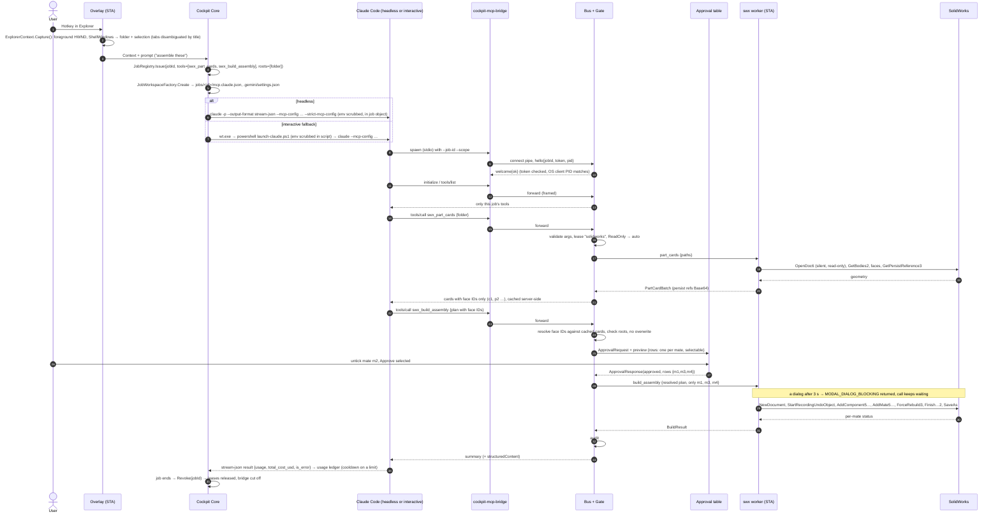

# AI Cockpit V5 — spec and implementation

Status as of 22 Oct 2026. Code: .NET 8, C# 12. V5 fixes Gemini's three "must fix" items, adds the Gemini CLI as a second engine with automatic failover, and adds the four missing tool providers (DaVinci Resolve, Blender, Code-CAD with build123d, linear algebra tutor), so every action in the overlay is live.

## 0. What was built and what was verified

| Part | Where | Compiled | Tested here (Linux) |
| --- | --- | --- | --- |
| Bus, bridge, gate, leases, audit, journal | `Cockpit.Protocol`, `Cockpit.Bridge`, `Cockpit.Core/Bus`, `Files` | Yes | Yes, end to end through the real bridge process |
| Claude + Gemini launch, stream parsers, usage ledger, router | `Cockpit.Core/Jobs` | Yes | Yes (stand-in CLI processes print fixtures; real CLIs not run) |
| Interactive sessions (sentinels, watcher, kill) | `Jobs/InteractiveSession.cs`, `Runtime` | Yes | Yes, with real child processes as the "terminal" |
| Resolve: probe, FCPXML 1.9 + EDL, Studio script | `Cockpit.Core/Resolve` | Yes | Yes; FCPXML **validated against Apple's FCPXML 1.9 DTD**; built-in reader **matches ffprobe** on real clips; Resolve itself not run |
| Blender scene + preview render | `Cockpit.Core/Blender` | Yes | Script **run on the real Blender 5.2.3 API** (bpy module): car moves 33.2 m of the planned 33.3 m, wheels roll within 0.01 rad, frame rendered with Cycles. Blender app CLI and 4.x not run |
| Code-CAD templates → STEP | `Cockpit.Core/CadCode` | Yes | **All 7 templates built by build123d 0.13** into STEP files inside their envelopes; oversize part refused |
| Tutor: PDF chapter, exact matrix checks | `Cockpit.Core/Tutor` | Yes | Yes; built-in PDF reader **matches PyMuPDF** (object streams, Type0 + ToUnicode); SymPy agrees with the exact results |
| STEP import into SolidWorks | `SwxWorker` (`LoadFile4` + `SaveAs3`) | Against the stub | Against the strict fake only |
| Console host, overlay ViewModels | `Cockpit.CliHost`, `Cockpit.UI` | Yes | Yes |
| WPF overlay incl. cursor-monitor placement | `Cockpit.Wpf` | **No** (needs Windows) | XAML bindings/resources checked statically |

**40 offline tests pass with zero warnings** (`bash verify/run-tests.sh`, warnings as errors), plus **4 live tests** that run the generated scripts for real when `COCKPIT_LIVE_PYTHON` points to a Python with build123d, bpy, PyMuPDF and sympy (`verify/live-requirements.txt`); all 44 pass here. The live tests found two real bugs that the fakes could not: QuickTime `.mov` handler parsing and a bfchar/bfrange regex in the PDF reader (both fixed, both now covered offline). Still unverified: anything on Windows (WPF, pipes ACL, job objects, `wt.exe`, `RegisterHotKey`, multi-monitor DPI), real SolidWorks, real Resolve, real `claude`/`gemini` runs.

## 1. V5 changes, item by item

1. **Interactive sessions.** The claimed race did not exist in V4 — V4 never watched `wt.exe` (it disposed the launcher and kept the job until End/Kill/expiry) — but the two real gaps behind it did: the job never ended when Claude exited, and Kill could not close the tab. Fixed with sentinel files, a watcher and terminal-tree kill (section 4). Test: the launcher exits immediately, the bridge connects 200 ms later and runs a tool call, the job stays Running until `interactive.done`; Kill ends the terminal; a closed tab, a recycled PID and a terminal that never starts are each handled.
2. **SolidWorks.** `SaveAs3(name, version, options, exportData, advancedOptions, ref errors, ref warnings)` replaces `SaveAs` (stub updated so the old call no longer compiles; **SaveAs3 needs SOLIDWORKS 2021 or later** — I believe that is when it was added; check your API help). Two of Gemini's three points were already true in V4: the base component was already selected (`Select4`) before `FixComponent`, and `SelectionManager` was already `object` in the stub with an explicit cast. V5 adds `ClearSelection2` after fixing and makes the fake strict (FixComponent with nothing selected does nothing and is counted); a mutation that skips the selection fails test #13. **New:** `swx_import_step` (`GetImportFileData` + `LoadFile4` + `SaveAs3`), because generated STEP files must become `.SLDPRT` before `swx_part_cards` can read them.
3. **Gemini CLI + failover.** `GeminiLaunchBuilder` runs `gemini --output-format stream-json --allowed-mcp-server-names cockpit [-m model] [--skip-trust]` in the job workspace (where `.gemini/settings.json` wires the bridge), prompt on stdin (non-TTY input runs Gemini headless). `GeminiStreamParser` reads init / message / tool_use / tool_result / error / result and the single-object `json` format; 429 / RESOURCE_EXHAUSTED becomes a cooldown ("retry in Ns", or next midnight Pacific for daily quotas, else 1 h), synthesized if the stream ends without a result. `ProviderRouter`: explicit provider or prefix first; cad, code, blender → Claude Code (fallback Gemini); tutor, files, resolve → Gemini (fallback Claude); a provider at its limit or not installed is replaced by the other with a notice, unless `NeverDowngrade`. Tests: Claude cooling → a CAD job runs on Gemini with settings.json wired to the bridge, Google variables scrubbed, the stream parsed and usage recorded; NeverDowngrade refuses with the reason and issues nothing; a Gemini 429 then leaves both limited and the error names both. Ledger keys are `claude-code` / `gemini-cli` (Gemini's spec said `claude` / `gemini`).
4. **DaVinci Resolve** — section 3.
5. **Blender** — section 3. The render tool does not pass `-E`: the `.blend` keeps the engine chosen when it was built, and the engine id differs between Blender versions (`BLENDER_EEVEE_NEXT` in 4.2–4.x, `BLENDER_EEVEE` in 5.x; the script picks whichever the running Blender offers).
6. **Code-CAD and Tutor** — section 3. Gemini's pipeline "STEP → swx_part_cards" needed the new import step (item 2).
7. **Overlay and CLI.** All seven actions are enabled (SolidWorks assembly, parametric parts, organize, Resolve rough cut, Blender scene, tutor, Claude Code terminal). The prompt router takes prefixes (`/cad /code /files /tutor /resolve /blender`) and keywords, picks the action, its tool allow-list and — through the runtime — the subscription; the matching header pill lights up and a warning line explains a failover before anything starts. A "Keep sub." toggle sets NeverDowngrade. The panel opens on the monitor under the mouse (GetCursorPos → MonitorFromPoint → GetMonitorInfo, placed with SetWindowPos in physical pixels and re-placed after a DPI change). CLI: `cockpit cad|resolve|blender|tutor <folder> --request "…"`, `cockpit matrix "[[…]]"`, `--provider`, `--keep-subscription`, `--gemini-skip-trust`; `doctor` checks Python modules, Blender, ffmpeg, Resolve's scripting folder and Gemini's stream-json / folder-trust support.

## 2. The overlay (Toolbox style)

`Ctrl+Shift+Space` (or a left click on the tray icon) opens a 420 px dark panel at the bottom-right of the monitor the mouse is on, above the taskbar. It hides on Esc or when it loses focus, **except while an approval is open**.

- **Header:** one pill per subscription (Claude Pro, Google AI Pro): green when ready, amber with "limit until HH:mm" from the usage ledger, and a blue outline on the one the current prompt would use.
- **Prompt box:** free text is routed with zero tokens; a line under the box says what Enter will do and on which subscription, and an amber line explains any failover or refusal. `/org`-style text searches the action list; `/tutor …`-style prefixes pick a category.
- **Context chips:** Explorer folder and up to 8 selected items (a selected PDF gives the tutor its folder); the foreground app as an off-by-default chip.
- **Tabs:** *Actions* (seven tool rows with icon, description, current subscription — hover for the tool allow-list — and a Run button), *Jobs (n)* (state, subscription, elapsed, launch mode, per-job Kill), *Activity* (tool calls and Claude/Gemini messages, errors in red).
- **Approval card** over the tabs while a call waits: per-row checkboxes for mates, cuts, parts and STEP files; the code of a custom build123d script; *Approve selected / Approve all / Deny / Kill job*.
- **Footer:** status line, *Keep sub.*, *Terminal* (interactive fallback), red **Kill all**.

## 3. Tool providers

| Tool | Risk | What it does | Notes |
| --- | --- | --- | --- |
| `resolve_probe_clips` | ReadOnly | Lists .mp4/.mov/.m4v/.mkv/.avi/.mxf/.wav/.mp3/.m4a/.aac with duration, exact fps (30000/1001), size, audio; ids c1… | ffprobe when installed, else a built-in MP4/MOV/WAV header reader (no MKV/MP3) |
| `resolve_export_timeline` | Write, selectable cuts | FCPXML 1.9 + CMX3600 EDL in `edits/` (never overwrites) | Times are whole frames as rationals; dissolves are `<transition>`s; tracks 2+ are connected clips (audio on negative lanes); the EDL holds track 1 only |
| `resolve_apply_studio` | Write, lease `resolve` | Writes `apply_resolve.py` (CreateProject → ImportMedia → ImportTimelineFromFile, fallback CreateEmptyTimeline + AppendToTimeline); runs it only with `run=true` | **External scripting needs Resolve Studio** with External scripting = Local; Resolve Free: import the .fcpxml by hand |
| `blender_build_car_scene` | Write | bpy script from approved numbers: Bezier road + flat road mesh, low-poly car whose wheels roll by distance/radius, instanced city blocks with emissive brick-pattern windows, street lights, chase camera; saves a new `.blend` | Runs `blender -b --factory-startup -P … --python-exit-code 1`; script only if Blender is missing |
| `blender_render_preview` | Write | PNG frames into a new folder; `preview.mp4` via ffmpeg | No lease: background renders can run in parallel |
| `cad_generate_parametric_step` | Write, selectable parts | build123d templates wheel_hub, brake_disc, coil_spring, strut_tube, control_arm, shaft, flange_bracket (mm), each checked against its `envelopeMm` and exported to STEP | Parameter ranges and geometric relations (bolt circle on the flange, pitch > wire, …) are checked before Python runs |
| `cad_generate_custom_step` | **Destructive** | A model-written build123d script for one part | Always asks; the approval shows the code |
| `swx_import_step` | Write, selectable files, lease `solidworks` | STEP → new .SLDPRT | `LoadFile4` + `SaveAs3`; never overwrites |
| `tutor_extract_pdf_chapter` | ReadOnly | Page range → `study_pack.md` in the job's artifacts (not next to the book) + outline | PyMuPDF when installed; else the built-in reader (classic + object streams, Flate, ToUnicode; no OCR, no encrypted PDFs) |
| `tutor_verify_matrix` | ReadOnly | Exact rational determinant, inverse, RREF, rank, transpose, product, characteristic polynomial, numeric + exact-rational eigenvalues, eigenpair checks, graded claims, optional SymPy script | Pure C#; decimals are read exactly (0.75 = 3/4) |

## 4. Process topology

```text
                      ┌───────────────────────────── Windows user session (medium integrity) ─────────────────────────────┐
  hotkey ──► AiCockpit.exe: Overlay (WPF view ─ CockpitOverlayViewModel) ──► CockpitRuntime (same process)               │
                                     ├─ JobRegistry (grants, tokens)      ├─ PermissionGate ──► approval UI (mate table)   │
                                     ├─ McpBusServer  \\.\pipe\ai-cockpit-bus (ACL: user only, network denied)              │
                                     │                 tcp 127.0.0.1:<ephemeral> only while a LoopbackTcp job exists        │
                                     ├─ LeaseManager (solidworks, resolve, …) ├─ AuditLog (SQLite, append-only)             │
                                     ├─ FileJournalService (SQLite WAL, synchronous=FULL)                                   │
                                     └─ ChildProcessJob (KILL_ON_JOB_CLOSE) ── owns every child below                       │
                                            │                                                                              │
          ┌─────────────────────────────────┼──────────────────────────────────┐                                           │
          ▼                                 ▼                                  ▼                                           │
   claude -p (headless,            Windows Terminal tab                 cockpit-swx-worker.exe                             │
   stream-json → ClaudeRunMonitor)
   gemini (headless, in the job     └ powershell launch-*.ps1 writes      └ STA thread + IOleMessageFilter ──COM──► SLDWORKS │
   workspace, stream-json)            interactive.pid / interactive.done
          │ spawns (stdio)           └ claude (interactive) spawns         (worker restarts on wedge; SolidWorks never      │
          ▼                            ▼                                     killed, never in the job object)              │
   cockpit-mcp-bridge.exe ───────── frames over the pipe ──────────► McpBusServer                                          │
   (--job-id, --scope from the generated MCP config)                                                                       │
                      └────────────────────────────────────────────────────────────────────────────────────────────────────┘
   WSL2 distro "cockpit" (automount off, interop off, /mnt/cockpit = exchange folder, memory capped):
      claude / gemini ─ spawns ─► cockpit-mcp-bridge (linux-x64) ── tcp 127.0.0.1 ──► McpBusServer
   Windows Sandbox (.wsb, networking off): untrusted scripts only; inputs read-only, one writable output folder.
   Helpers run to completion in their own job object (DefaultProcessRunner): ffprobe, ffmpeg, blender -b, python -I
   (build123d — optionally inside the WSL distro —, PyMuPDF, the Resolve scripting API).
```

`cockpit.exe` (Cockpit.CliHost) hosts the same `CockpitRuntime` without the overlay, on a private pipe `ai-cockpit-cli-<pid>` so it can run while the overlay owns `ai-cockpit-bus`; its approvals are asked in the console.

A tab opened by `wt.exe` is a child of Windows Terminal, not of the Core, so it is outside the job object, and `wt.exe` itself exits within milliseconds. The Core therefore never watches the launcher: the generated script records its own PID and start time in `interactive.pid` and writes `interactive.done` (the CLI's exit code) in a `finally` block. A watcher ends the job on `done`, on a closed tab (PID gone, no `done`), when the terminal never starts (2 min), or after 2 h without tool calls; Kill revokes the token **and** ends the recorded PowerShell's process tree (PID and start time must both match, so a recycled PID is never killed).

## 5. Sequence: hotkey to assembly



## 6. Bus protocol

**Transport.** `\\.\pipe\ai-cockpit-bus` (byte mode) or loopback TCP. Each grant is bound to one transport (`BusTransport.NamedPipe` or `LoopbackTcp`); a valid token presented over the other one is rejected and audited (`bus/handshake`, token not logged). The TCP listener is **off by default**: it binds `127.0.0.1:0` (an ephemeral port) when the first LoopbackTcp grant is issued and stops when the last one is revoked or expires; the port goes into that job's MCP config. Unauthenticated TCP sockets get **2 s** to send hello (pipes 10 s), and at most 8 may be in the handshake at once. Each frame is a 4-byte little-endian length followed by that many bytes of UTF-8 JSON without a BOM; the maximum is 16 MiB. One frame carries one JSON-RPC message.

**Handshake.** The first frame from the bridge is `{"type":"hello","protocolVersion":1,"jobId","token","bridgePid","transport"}`. The Core answers `{"type":"welcome","ok":true|false,"error","serverVersion"}` and closes on failure. A rejected bridge exits with code 3 and tells the client why on stderr.

**After the handshake** frames are raw MCP JSON-RPC 2.0, passed through unchanged. The Core implements `initialize` (echoes a supported `protocolVersion`, else offers its newest), `ping`, `tools/list`, `tools/call`, and honours `notifications/cancelled`. Other methods return -32601. Unknown or ungranted tools return -32602 and are audited as probing. Tool failures, denials and timeouts are returned as `result.isError: true` with text the model can act on (for example "The user denied this action. Do not retry it").

**Approval responses** may narrow a call: `ApprovalResponse(Approved, ApprovedRows, KillJob)`. Providers whose preview is selectable (`{kind,title,summary,selectable,rows:[{key,primary,detail,confidence?}]}`) receive `ToolCallContext.ApprovedRows` and must honour it; the build tool tells the model how many mates were excluded and not to add them back. Decisions are audited as `auto`, `approved`, `approved_subset`, `denied`, `killed`, `timed_out`, `cancelled` or `rejected`.

**Request IDs** are matched by value (`s:<string>` or `n:<number>`), not raw text, because the Core re-serializes IDs and may escape them differently.

**Timeout ladder** (each layer must be longer than the one inside it):

| Layer | Default | Where |
| --- | --- | --- |
| Message filter retry on a busy SolidWorks | 90 s per COM call | `SwxHostOptions.BusyRetryWindow` |
| Approval wait | 5 min | `JobGrant.ApprovalTimeout` |
| Tool execution | 10 min (cards), 15 min (build), 2 h (file batches) | `ToolDescriptor.ExecutionTimeout` |
| Worker kill grace | +20 s over the execution timeout | `SwxWorkerOptions.KillGrace` |
| Bridge request deadline | 20 min | `--timeout-seconds` |
| Client MCP timeout | 20 min + margin | `MCP_TOOL_TIMEOUT` (Claude Code), `timeout` (Gemini settings) |

A client-side timeout after approval does not stop a SolidWorks build that has already started; the result is still audited and shown in the overlay.

## 7. Security model

| Threat | Control | Where enforced |
| --- | --- | --- |
| Another user or machine connects to the bus | Pipe ACL: current user allow, NETWORK deny; owner set to the user | `PipeSecurityFactory` |
| A process squats the pipe name first | `FirstPipeInstance` on the first instance; client uses `CurrentUserOnly` | `McpBusServer`, bridge |
| Any local process connects to the TCP port | Listener only while a WSL job exists, ephemeral port, 2 s hello deadline, 8 pending max, per-grant transport binding | `McpBusServer`, `JobRegistry` |
| One job uses another job's tools or folders | Per-job token, grant lookup, tool allow-list, folder roots on every path | `JobRegistry`, `BusConnection`, providers |
| Prompt injection calls a write tool | Write and Destructive ask; Destructive can never be auto (also not with `--yes`); denial is final for that call | `PermissionGate`, `AutoApprovalPrompt` |
| The user approves more than they meant | Selectable previews; only ticked rows execute | providers via `ApprovedRows` |
| Model fabricates SolidWorks references | The model only sees face IDs; references stay in the Core's cache | `SwxToolProvider` |
| File loss | Same-volume renames only; no overwrite; no delete except empty folders the batch created; protected paths; write-ahead journal; `cockpit rollback` | `FileJournalService` |
| Silent API billing | Variables scrubbed from every child incl. both interactive scripts (Claude: API keys, Bedrock/Vertex; Gemini: `GEMINI_API_KEY`, `GOOGLE_API_KEY`, `GOOGLE_GENAI_USE_VERTEXAI`, `GOOGLE_CLOUD_PROJECT`, `GOOGLE_APPLICATION_CREDENTIALS`); Claude's `apiKeySource` checked on every headless run (Gemini reports no equivalent, so the scrub is its only guard); opt-in per job only | `CliLaunchBuilder`, `ClaudeRunMonitor`, `CockpitRuntime` |
| Model-written code | Templates take numbers only; custom build123d code is a separate **Destructive** tool (always asks, shows the code); Python runs with `-I`; build123d can run inside the restricted WSL distro | `CodeCadToolProvider`, `WslPythonRunner` |
| Model invents media or cut points | Clips are referenced by probe ids; cuts outside a clip are refused; the Resolve script takes media from the exported timeline, not from the model | `ResolveToolProvider` |
| Helper programs hang | Every helper runs with a timeout in its own kill-on-close job object; Blender with `--factory-startup` (no user add-ons) | `DefaultProcessRunner` |
| Runaway job | Kill switch: revoke grant (calls cancelled, leases released, connections closed) + terminate the job object | `CockpitRuntime.KillJob` |
| Orphaned children | Job object with kill-on-close | `ChildProcessJob` |
| Audit tampering by the agent | Append-only triggers; no tool touches the audit DB | `AuditLog` |

**Terms of service.** The Cockpit only drives the official `claude` and `gemini` CLIs, signed in by you, and never reads, copies or replays their OAuth tokens. Whether scripted or headless use of a consumer subscription (Claude Pro, Google AI Pro for students) is permitted, and what usage limits apply, is set by the providers' current terms and can change: **verify the current Anthropic consumer terms / Claude Code usage policy and the Google AI Pro and Gemini CLI terms before relying on headless jobs.** The interactive terminal mode is the conservative choice. Media generation (Nano Banana, Veo) is not automated. Automatic failover moves work between your two subscriptions; it never switches to an API key.

## 8. Isolation configuration

**WSL distro** (`WslIsolation`): `/etc/wsl.conf` disables automount and interop and turns on `mountFsTab`. `/etc/fstab` binds one exchange folder, configured once at setup because mounts are fixed at distro start. Repositories live on the distro's ext4 disk as git worktrees, one per job; only artifacts cross the exchange folder. `%UserProfile%\.wslconfig` caps memory (for example 8 GB with SolidWorks open) and enables mirrored networking for the TCP bus.

**Windows Sandbox** (`WindowsSandboxConfig`): the generated `.wsb` disables networking, GPU, clipboard, printer, audio and video, enables `ProtectedClient`, maps inputs read-only and one output folder read-write, and optionally runs a logon command. Launch it with `WindowsSandbox.exe <file>.wsb`.

## 9. Day-1 bug checklist

| # | Bug you will hit | Symptom | How the code prevents it |
| --- | --- | --- | --- |
| 1 | **Zombie `SLDWORKS.exe`** after a crash or an automation-launched instance | Hidden SolidWorks holding licences and RAM; next attach grabs the wrong instance | Attach to the user's instance by default (`AllowLaunch` off). A launched instance is made `Visible = true`, so it is never hidden. `ShutdownAsync` closes only documents the Cockpit opened and calls `ExitApp` only if the Cockpit launched SolidWorks and nothing is open. RCWs are released (`FinalReleaseComObject`, GC after each STA item). The worker is in a kill-on-close job; SolidWorks is not. |
| 2 | **Elevation (UIPI) mismatch** | `GetActiveObject` returns `MK_E_UNAVAILABLE` although SolidWorks is visibly running | `ProcessIntegrity.IsInaccessibleOrMoreElevated` detects an elevated or other-user `SLDWORKS.exe` and reports "restart SolidWorks normally". The worker refuses to run elevated (`Environment.IsPrivilegedProcess`). A genuinely still-starting SolidWorks is retried for `AttachWait`, since it registers in the ROT only after startup. |
| 3 | **BOM and code-page corruption on stdio** | Claude Code or Gemini rejects the first message; non-ASCII paths garbled | Raw stdin/stdout streams with BOM-free UTF-8 (`StdioJsonLines`); a leading BOM on input is stripped; `Console.Out` is redirected to stderr so stray `Console.WriteLine` cannot corrupt the stream; child processes get explicit BOM-free `Standard*Encoding`. The reverse case: the interactive `.ps1` is written **with** a BOM because Windows PowerShell 5.1 reads BOM-less scripts as ANSI. |
| 4 | **Named-pipe deadlock or torn frames** | Bridge and Core both block; random JSON parse errors under load | One read loop per connection and a separate `FrameWriter` that writes header and payload in one call and never waits for a reply while holding the lock. Each request runs as its own task. Writes are not cancelled midway. Frames are length-prefixed and size-capped. |
| 5 | **`RPC_E_SERVERCALL_RETRYLATER` and modal dialogs** | Calls throw during rebuilds; a dialog hangs the worker forever | `ComMessageFilter` retries RETRYLATER for 90 s. **New in V4:** after 3 s blocked, a stall probe asks `ISwxDialogDetector` (Win32: visible `#32770` window of the SolidWorks PID, or a disabled main window) and, if SolidWorks shows a dialog, releases the caller with `MODAL_DIALOG_BLOCKING` {title, text, buttons}; the model is told not to retry and the user to answer the dialog. The call itself keeps waiting (COM calls cannot be aborted). A per-item watchdog in `DedicatedStaQueue` marks the queue wedged if a call overruns; the worker exits with code 3 and the Core starts a fresh one on the next call. The Core also kills the worker if no reply arrives within the timeout plus grace. SolidWorks is never killed. |
| 6 | **Duplicate or lost JSON-RPC responses** | Client errors "unknown id", or a request hangs until timeout | The bridge answers locally on its deadline, forwards `notifications/cancelled`, and drops any late reply. IDs are matched by value, so an ID the Core re-escapes (`"é"` vs `"\u00E9"`) still matches; this bug was found and fixed during the build and is covered by a test. Duplicate in-flight IDs are rejected. |
| 7 | **Face references break, or a source part is modified** | Mates fail with "face not found" after reopening a part; SolidWorks prompts to save parts | Persist reference first, then existing or in-memory entity name, then geometric re-match; ambiguity is reported, not guessed. Parts are opened read-only and never saved; the assembly is always a new file and never overwrites. Half-built assemblies are closed without saving. |
| 8 | **CLI launch failures and silent API billing** | `Process.Start("claude")` fails (npm shim is `claude.cmd`); a Windows Terminal tab ignores the scrubbed environment and bills `ANTHROPIC_API_KEY` | `ResolveOnPath` honours PATHEXT and `.cmd` shims run through `cmd /d /s /c` with prompts only on stdin, so cmd metacharacters cannot be injected. The interactive tab runs a generated script that removes every billing variable itself. `MCP_TOOL_TIMEOUT` is set so the client outlasts the bridge. **New in V4:** the `system/init` event's `apiKeySource` is checked on every headless run; anything but `none` raises a billing alarm (red banner) and kills the job unless metered billing was opted in for it. |

| 9 | **Interactive job dies at once, or outlives its tab** | `wt.exe` returns in ~50 ms; a job tied to it would revoke its own token before Claude starts; a killed job leaves the tab running | Sentinel files instead of the launcher process (section 4); Kill ends the recorded shell tree. Tested with a launcher that exits immediately and a bridge that connects 200 ms later. |
| 10 | **QuickTime `.mov` read as audio-only** | iPhone/camera clips missing from the rough cut | A `.mov` has a second `hdlr` (data handler) inside `minf`; only the first (media) handler counts. Found by comparing the built-in reader with ffprobe on real files; regression test added. |

Also handled: Windows 11 Explorer tabs share one window handle (disambiguated by title, else the overlay asks); folders that are mount points for another disk (volume comparison, so a "move" never silently becomes copy and delete); OneDrive placeholders (refused, since moving them downloads them); files open for writing (fingerprinting opens without write sharing, so they fail instead of moving mid-write); SolidWorks lock files `~$*.sldprt` (skipped).

## 10. To verify on your machine

**SolidWorks API surface used** (check names and signatures in the API help for your version; the ship build against your interop is the first real check):

- `SldWorks`: `Visible`, `CommandInProgress`, `RevisionNumber()`, `GetProcessID()`, `GetOpenDocumentByName`, `OpenDoc6`, `NewDocument`, `GetUserPreferenceStringValue`, `CloseDoc`, `GetDocumentCount`, `ExitApp`, **`GetImportFileData`**, **`LoadFile4`**
- `ModelDoc2`: `Extension`, `FeatureManager`, `ActiveView`, `SelectionManager` (object → `SelectionMgr`), `GetTitle`, `GetConfigurationNames`, `ForceRebuild3`, `ClearSelection2`, `FirstFeature`
- `SelectionMgr.CreateSelectData()`, `SelectData.Mark`
- `ModelDocExtension`: `GetPersistReference3`, `GetObjectByPersistReference3`, `StartRecordingUndoObject`, `FinishRecordingUndoObject2`, `GetUserPreferenceInteger`, `CreateMassProperty`, **`SaveAs3`** (SOLIDWORKS 2021+, to my knowledge)
- `PartDoc`, `AssemblyDoc` (`AddComponent5`, `FixComponent`, `AddMate5`), `Component2` (`GetCorrespondingEntity`, `Select4`), surfaces and features as in V4.
- Whether your student/educational licence permits API automation, and whether STEP import produces solid bodies for the generated parts.

**Claude Code:** `-p --output-format stream-json --verbose --mcp-config <file> --strict-mcp-config --allowedTools mcp__cockpit --max-turns N` (prompt on stdin) and its stream-json field names (fixture reconstructed, not captured). **Gemini CLI:** flags confirmed against the current CLI reference (`--output-format stream-json`, `--allowed-mcp-server-names`, `-i`, `-m`; non-TTY input runs headless); event names confirmed (`init`, `message`, `tool_use`, `tool_result`, `error`, `result`; fields `session_id`, `role`, `content`, `tool_name`, `status`, `error.message`, `severity`); **token-stat field names are not documented** — the parser accepts flat `stats.input_tokens/output_tokens` and per-model `stats.models.<m>.tokens.{prompt,candidates,cached}`; capture a real run and add it as a fixture. If Gemini's folder trust is on, pass `--gemini-skip-trust` or trust the jobs folder, otherwise Gemini ignores the job's MCP config. Headless Gemini on a Google AI Pro login uses that plan's Gemini CLI quota; check Google's current terms and limits.

**DaVinci Resolve:** scripting names from Resolve's scripting README (`scriptapp`, `GetProjectManager`, `CreateProject`, `GetMediaPool`, `ImportMedia`, `ImportTimelineFromFile` with `timelineName`/`importSourceClips`, `CreateEmptyTimeline`, `AppendToTimeline`, `SaveProject`, `OpenPage`); FCPXML 1.9 import in your Resolve version (validated against Apple's DTD, not imported); dissolves need media handles beyond the cut points. To repeat the DTD check: get `FCPXMLv1_9.dtd` (Apple; e.g. from the CommandPost project) and validate an exported file with `xmllint --dtdvalid`.

**Blender:** the scene script was run on 5.2.3 only; 4.2–4.x paths (`BLENDER_EEVEE_NEXT`, `use_nodes`) are written but untested; the `blender -b … -a` render command line is untested (the live test drives bpy as a module).

**Code-CAD:** the templates are simplified shapes for fit and assembly checks, not engineering models (no fillets, a solid brake-disc hat, a ground-flat spring is not modelled). Real dimensions come from your measurements.

**Windows:** the WPF project has never been compiled — expect small fixes on the first build; `RegisterHotKey`, `NotifyIcon`, per-monitor DPI placement, `wt.exe` + PowerShell sentinels, `winsqlite3.dll` for the verify suite on Windows.

## 11. Build and run

```powershell
# Windows: ship build + publish to .\dist + doctor (finds SolidWorks interop in the registry)
powershell -ExecutionPolicy Bypass -File scripts\check-windows-build.ps1 -RunVerifySuite
#   options: -SolidWorksInteropDir <dir>  -CheckSolidWorks  -AotBridge  -SkipWpf

# Any OS, offline (no NuGet, no SolidWorks): builds with warnings as errors and runs the 40 tests
bash verify/run-tests.sh
# … plus the 4 live tests that run the generated scripts for real
python -m venv .venv && .venv/bin/pip install -r verify/live-requirements.txt
COCKPIT_LIVE_PYTHON=$PWD/.venv/bin/python bash verify/run-tests.sh
```

```text
cockpit doctor [--check-swx]
cockpit assemble D:\Jetta\parts                                     # SolidWorks assembly (Claude Pro by default)
cockpit cad D:\Jetta\parts --request "front corner: hub 5x112, 288 mm disc, spring"
cockpit resolve D:\Videos\trip --request "60 s teaser, music under"   # Google AI Pro by default, Claude if Gemini is limited
cockpit blender D:\Renders --request "red car through a neon city at night, 8 s"
cockpit tutor D:\Books --request "chapter 3 (pages 41-58), eigenvalues"
cockpit matrix "[[2,1,1],[1,2,1],[1,1,2]]"                           # exact, no AI
cockpit organize D:\Downloads --criteria "group by type" --provider claude --keep-subscription
cockpit rollback <jobId>
AiCockpit.exe                                                        # the overlay: tray icon + Ctrl+Shift+Space
```

Recommended for Code-CAD: install build123d inside the restricted WSL distro and configure `CadPython` as a `WslPythonRunner` (outputs under the exchange folder), so model-chosen parameters and any approved custom script run away from your Windows files.

**Not built:** Hyper-V POC VM flow, a settings page (runner choices are code/CLI options today), OCR for scanned PDFs, Gemini-specific billing detection (Gemini reports no auth source).
